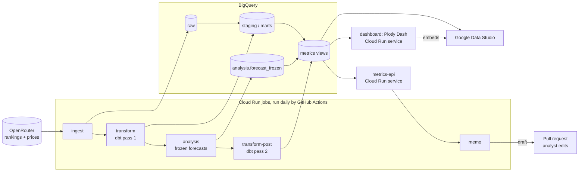
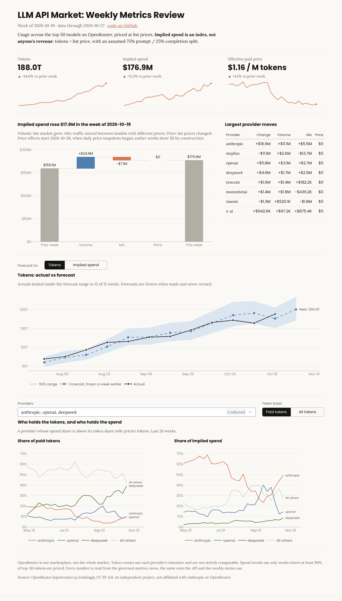

# LLM API Market Metrics

An automated weekly metrics review of the LLM API market, built the way a finance analytics team would run one: public usage data in, governed metric definitions in dbt, a weekly memo explaining what moved and why, and two dashboards (Plotly Dash and Google Data Studio) that read the same numbers, behind one front door that lets each visitor choose.

**Live:** [dashboard](https://dashboard-2cehw44wga-uc.a.run.app) · [API docs](https://metrics-api-2cehw44wga-uc.a.run.app/docs) · [Data Studio report](https://datastudio.google.com/reporting/9eaf6a67-8c9b-44df-bece-b5aaf7d1e203). Refreshed daily by GitHub Actions on Cloud Run.

> **Status:** complete and running daily on Cloud Run since 2026-10-29. Built with Claude Code.

## What it answers each week

- **Why did spend move?** A price-volume-mix bridge splits the week-over-week change in implied spend.
- **Are we on plan?** Each Monday's forecast is frozen, then compared with actuals and its prediction interval.
- **What is about to change?** Adoption curves for newly launched models, and providers whose spend share and token share diverge.

## Architecture



Six containerized services on Google Cloud Run, sharing one BigQuery warehouse. They pass data only through BigQuery tables and one read-only HTTP API. GitHub Actions deploys every service after CI passes on main and runs the jobs in order each day; it signs in to Google through Workload Identity Federation, so no service account key exists anywhere.

| Service | Runs as | Status |
| --- | --- | --- |
| `ingest`: OpenRouter rankings and model prices to the raw layer | Cloud Run job | Deployed, tested |
| `transform`: dbt staging, price history, marts, metrics | Cloud Run job | Deployed, tested |
| `analysis`: frozen forecasts (the spend bridge lives in dbt) | Cloud Run job | Deployed, tested |
| `metrics-api`: read-only FastAPI over the metrics | Cloud Run service | Deployed, tested |
| `memo`: weekly memo drafted by Claude, checked against the data | Cloud Run job | Deployed, tested |
| `dashboard`: the front door: Plotly Dash views, a toggle to Google Data Studio, links to code, API and memos | Cloud Run service | Deployed, tested |

## Dashboards

A Plotly Dash app (`services/dashboard`) serves the four views at http://localhost:8050:
headline tiles, the spend bridge, actual vs frozen forecast, and provider share. A [Google Data
Studio report](https://datastudio.google.com/reporting/9eaf6a67-8c9b-44df-bece-b5aaf7d1e203) reads the same BigQuery views live; the
app's toggle switches between the two. See [`dashboards/`](dashboards/).



## Why spend moved: the bridge

Each week's change in implied spend splits into three parts, per model, that add up exactly (tested on every build):

- **Volume:** the market grew or shrank, at last week's prices and mix.
- **Mix:** a model gained or lost share, at its last-week price.
- **Price:** a model's own price changed.

For the week of 2026-10-19, implied spend rose $17.8M: +$24.9M from volume and -$7.1M from mix as traffic shifted toward cheaper models. Anthropic added $16.6M; StepFun lost $13.7M of share. Price effects are measured only from 2026-10-28, when daily price snapshots began; before that, prices are backfilled and constant.

## Are we on plan: frozen forecasts

The "plan" is a statistical forecast, because there is no budget for a public market. Each week the `analysis` service forecasts tokens and implied spend 1 to 4 weeks ahead and appends them to `analysis.forecast_frozen`. A stored forecast is never rewritten, even when the data behind it is revised, so the comparison with actuals is fair. dbt then joins forecasts to actuals in `metrics.forecast_vs_actual` and scores them in `metrics.forecast_accuracy`.

- **Models:** naive, drift and a log-linear trend on log values. Each week picks the model with the lowest error over the previous 26 weeks, using only errors that were knowable at the time. A test proves every forecast equals the one made from history truncated at its origin.
- **Intervals:** split-conformal 90% intervals from the same 26 weeks of backtest errors, per horizon. No interval is shown until 9 errors exist.
- **Backfill:** on the first run, forecasts for past weeks are rebuilt from history without lookahead and flagged `is_backfill`; accuracy is reported for all forecasts and for live ones only.

Track record on the full history (backfilled forecasts, weeks through 2026-10-19):

| Horizon | Tokens: inside 90% interval | Tokens: mean abs. error | Implied spend: inside 90% interval | Implied spend: mean abs. error |
| --- | --- | --- | --- | --- |
| 1 week | 93% | 9.6% | 87% | 11.4% |
| 2 weeks | 94% | 16.1% | 86% | 16.7% |
| 3 weeks | 88% | 21.1% | 85% | 19.0% |
| 4 weeks | 85% | 24.6% | 87% | 23.1% |

Two honest readings. Coverage slips below 90% at longer horizons and for spend, because the market's growth rate keeps changing and the calibration window lags it. And forecasts run low on average (actuals beat the forecast by 2% at 1 week and 12% at 4 weeks for tokens): growth has been accelerating, which a drift model trails by design. Both are reported, not tuned away.

## The weekly memo

Claude drafts the memo from a facts file built from the metrics API; it is told to use only numbers that appear there, copied exactly. Each memo also reports the week against the forecast frozen a week earlier ("Against plan"). A checker then extracts every number and date from the draft and rejects the memo if any is missing from the facts, so a rounded, added-up or invented figure cannot reach a reader. An analyst edits each draft before it is merged into [`memos/`](memos/). See [`memos/README.md`](memos/README.md).

## Governed metrics

Each metric is defined once, in dbt's semantic layer (`models/semantic/_semantic.yml`), and validated against the warehouse with MetricFlow. Consumers read two views in the `metrics` schema whose columns carry the metric names: `weekly_kpis` (headline) and `provider_weekly` (driver view). CI queries MetricFlow and fails if either disagrees with the view, so the definitions and what people see cannot drift apart.

| Metric | Definition |
| --- | --- |
| `tokens` | All tokens, top 50 plus the "other" bucket |
| `paid_tokens` | Top-50 tokens excluding free variants and stealth previews |
| `implied_spend_usd` | Tokens x blended list price; an index (see sensitivity below) |
| `effective_paid_usd_per_mtok` | Implied spend per million priced paid tokens |
| `priced_coverage` | Share of top-50 tokens with a known price |
| `zero_priced_share` | Share of top-50 tokens served free |
| `new_model_share` | Share of top-50 tokens from models within 56 days of entering the top 50 |

Provider token share and spend share are the same metrics for one provider divided by the market.

## Data quality, by design

- **Completeness:** every day has exactly 51 rows (top 50 + "other"), and no day is missing except two dates the source itself lacks, listed with evidence in `seeds/known_source_gaps.csv`.
- **Point-in-time prices:** list prices form a type-2 history built from daily snapshots of the model list, so a price cut never rewrites past spend. It is a model rebuilt from raw data, not a dbt snapshot, so it is reproducible from scratch.
- **Exact pricing joins only:** usage joins to prices on a key rebuilt in the rankings' own format (canonical slug plus `:variant`). No fuzzy matching: `ministral-8b` is not assumed to cost what `ministral-8b-2512` costs.
- **Zero-priced traffic is labeled, not hidden:** `:free` variants and stealth preview models are flagged in staging and priced at zero downstream.
- **Every price has a basis:** each day's tokens carry how they were priced: listed, retired-model list price (from a seed where every row cites its source), free, stealth preview, or unpriced.
- **Reconciliation:** weekly provider and market tables add back to the daily facts to the token, tested on every build.

## Pricing coverage

OpenRouter drops retired models from its price list, so older history has more unpriced volume. Retired paid models that carry most of it are priced from a cited seed (`seeds/retired_model_prices.csv`); the rest stays unpriced and is measured instead of hidden.

| Basis | Share of all tokens, Jan 2025 to Oct 2026 |
| --- | --- |
| Listed price | 75.5% |
| Free variants | 8.9% |
| Outside the top 50 ("other" row, no single price) | 6.6% |
| Stealth previews (free) | 4.0% |
| Retired model, sourced list price | 3.9% |
| Unpriced | 1.1% |

Priced coverage of top-50 tokens is reported every week. Spend trends use only complete weeks with at least 90% coverage (`is_spend_reliable`), which holds from July 2025 onward.

## How much the spend assumption matters

OpenRouter does not publish the split between prompt and completion tokens, so implied spend blends the two prices with a stated prompt share (default 75%, `var('prompt_token_share')`). For the week of 2026-10-19:

| Prompt share | Implied spend | Anthropic share of spend | DeepSeek share of spend |
| --- | --- | --- | --- |
| 50% | $265M | 49.2% | 7.8% |
| **75% (default)** | **$177M** | **49.2%** | **8.6%** |
| 90% | $124M | 49.3% | 9.5% |
| 95% | $106M | 49.3% | 10.0% |

The level moves by a factor of 2.5 across plausible splits; provider shares barely move. So the weekly review leads with shares and changes and treats the dollar level as an index.

## What I got wrong

- **I lost history to a default I never set.** The BigQuery datasets were created before billing was on, and sandbox datasets expire tables and partitions after 60 days. The raw layer quietly kept only 8 complete weeks, and the forecast service then produced nothing, without an error. Now setup clears every expiration, the ingest sink refuses to write to a table that can expire, and the forecast service logs a warning saying how many weeks it found when it cannot forecast.
- **I assumed I could get past prices.** OpenRouter publishes only today's price list, and drops retired models from it. So the price effect in the bridge starts on 2026-10-28, when daily snapshots began; earlier weeks show $0 by construction. Retired models that carried real volume are priced from a seed where every row cites its source, and what stays unpriced is reported every week instead of being dropped.
- **I led with dollars that were mostly an assumption.** Implied spend moves by a factor of 2.5 depending on the unpublished prompt/completion split. Provider shares barely move, so the review now leads with shares and changes and labels spend as an index.
- **The forecasts are biased low, and I left them that way.** Growth accelerated over the history, which a drift model trails, and interval coverage slips below 90% at four weeks. Retuning on the same history would make the backtest look better and say nothing about next week, so the track record is published as is.
- **I picked the BI tool three times.** Hex needed a work email, and Tableau Public would have needed a manual export to a Google Sheet, so I dropped both. What saved the rework was that every chart reads from BI-shaped dbt views (`metrics.dash_*`), so changing tools meant rebuilding charts, not redefining numbers.

## Data and caveats

- **One marketplace, not the market.** OpenRouter routes developer traffic; direct API traffic to any provider is not visible here.
- **Tokens are not comparable across providers**, which count with their own tokenizers.
- **Spend is implied**: tokens times list price, with a stated prompt/completion blend. It is an index, not anyone's revenue.
- **Price history starts when this project started**, from daily snapshots of the model list.

Source: OpenRouter ([openrouter.ai/rankings](https://openrouter.ai/rankings)), licensed CC BY 4.0. As-of dates are recorded with every row.
## Run it locally

Requires Docker and an [OpenRouter API key](https://openrouter.ai/settings/keys).

```bash
cp .env.example .env                              # add OPENROUTER_API_KEY
docker compose run --rm ingest probe              # day-1 checks: shape, prices, slug join
docker compose run --rm ingest rankings --backfill
docker compose run --rm ingest prices
```

With `SINK=local`, raw data lands as JSON Lines under `data/raw/`, one file per date. Reruns replace a date's file rather than duplicating it; the BigQuery sink does the same with a transactional partition swap.

```bash
docker compose run --rm transform                 # dbt build into the warehouse volume
docker compose run --rm analysis                  # freeze this week's forecasts
docker compose run --rm transform-post            # dbt build of the forecast-vs-actual views
```

The same dbt project runs on DuckDB locally and in CI (`--target local`) and on BigQuery in production (`--target bigquery`).

```bash
docker compose up                                 # ingest, dbt, forecasts, dbt, then the API on :8080
```

The API's interactive docs are at http://localhost:8080/docs. Endpoints: `/as-of`, `/kpis`, `/kpis/history`, `/providers`, `/bridge` (each takes `week=`, a Monday, and defaults to the latest complete week), `/forecast` (latest forecast and track record) and `/forecast/history`. It reads only the `metrics` views, so it cannot disagree with the dashboards or the memo.

## Run it on BigQuery

The same containers run against BigQuery with one override file. You need a GCP project with
billing on (set a $10 budget alert; at this data size BigQuery stays inside the free tier).

```bash
# in .env: GCP_PROJECT=<your project id>
docker compose -f docker-compose.yml -f docker-compose.bigquery.yml run --rm gcloud            # sign in, datasets, read-only account
docker compose -f docker-compose.yml -f docker-compose.bigquery.yml run --build --rm ingest copy-local # copy the local raw layer
docker compose -f docker-compose.yml -f docker-compose.bigquery.yml up --build                  # the whole pipeline and API
```

To skip the `-f` flags, set `COMPOSE_FILE` in `.env` (see `.env.example`).

`infra/gcp/setup.sh` is safe to rerun. It authorizes the `metrics` dataset to read `marts` and
`analysis`, so anything that reads the governed views needs access to nothing else.
Credentials stay in a Docker volume, never in the repo.

## Deploy to Cloud Run

| Runs as | What | Service account | Can |
| --- | --- | --- | --- |
| Service | `metrics-api`, `dashboard` (public) | `metrics-reader` | run queries, read the `metrics` dataset |
| Job | `ingest`, `transform`, `analysis`, `transform-post`, `memo` | `pipeline-runner` | write the warehouse datasets, read the two API keys, write memo drafts |
| GitHub Actions | build, deploy, run jobs | `github-deployer` | only from this repository, via Workload Identity Federation |

One-time setup, after the BigQuery setup above (API keys come from `.env` and go to Secret
Manager; the script never prints them):

```bash
docker compose -f docker-compose.yml -f docker-compose.bigquery.yml run --rm --entrypoint bash gcloud /setup/bootstrap.sh
```

Then add the three repository variables it prints (`GCP_PROJECT`, `GCP_REGION`,
`WIF_PROVIDER`) under Settings > Secrets and variables > Actions > Variables, and allow
Actions to open pull requests (Settings > Actions > General > Workflow permissions).

- [`deploy.yml`](.github/workflows/deploy.yml): after CI passes on main, builds the six
  images, deploys the two services and five jobs, and smoke-tests the API and dashboard.
- [`daily.yml`](.github/workflows/daily.yml): each morning runs ingest, dbt, forecasts and
  dbt's second pass, each waiting for the last. On Tuesdays it also drafts the memo into a
  Cloud Storage bucket and opens a pull request with it, so a person edits every memo before
  it is published.
