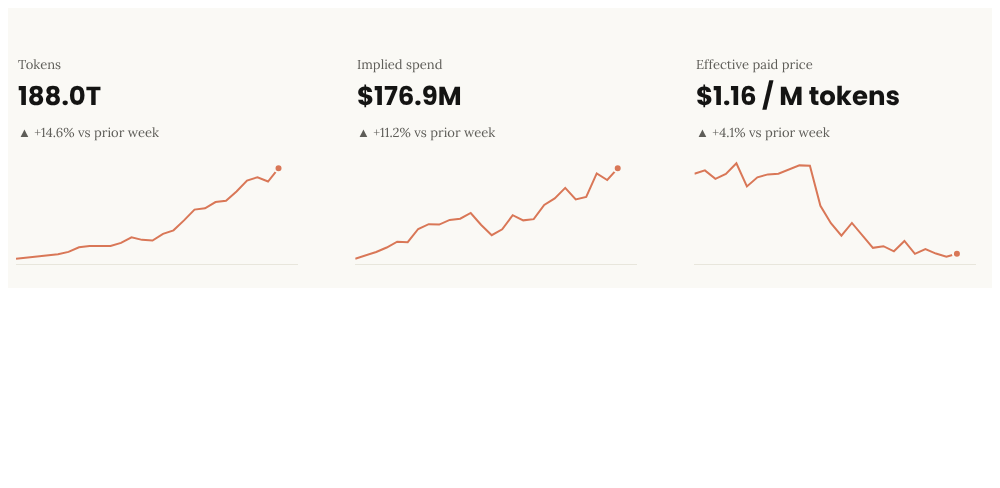
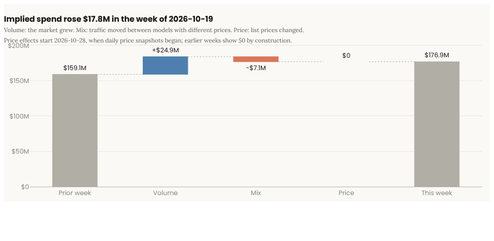
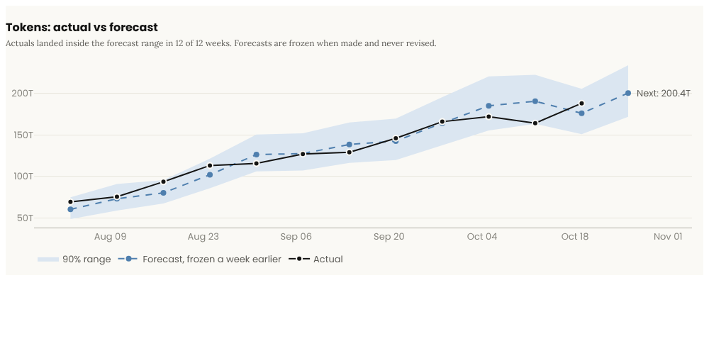
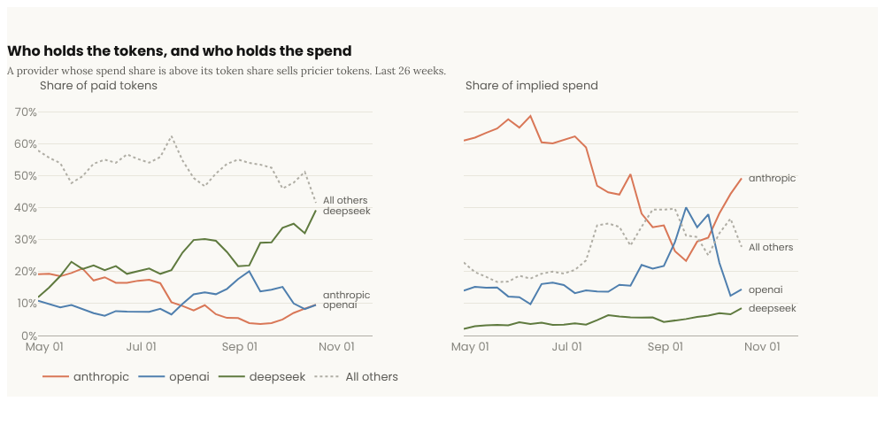

# Hex dashboard

The Hex app shows the four views the project plan calls for, read straight from the `metrics`
views in BigQuery:

| View | Cell | What it answers |
| --- | --- | --- |
| Headline tiles | `python/02_headline.py` | Tokens, implied spend and effective paid price: this week, change, 26-week trend |
| Spend bridge | `python/03_bridge.py` | Why spend moved: volume, mix and price, adding up exactly |
| Actual vs forecast | `python/04_forecast.py` | Are we on plan: each week against the forecast frozen a week earlier |
| Provider share | `python/05_providers.py` | Who holds tokens versus who holds spend, filterable by provider and paid/free |






*Screenshots from `preview.py` on the local warehouse; the portal shows them if the Hex embed is unavailable.*

The cells live here as plain files so they are reviewed and versioned like the rest of the code.
The SQL runs unchanged on BigQuery (in Hex) and DuckDB (locally and in CI), and CI runs every
cell against a fixture warehouse through `preview.py`, so a renamed column breaks the build
rather than the dashboard.

```bash
python dashboards/hex/preview.py --duckdb data/warehouse.duckdb --out build/hex   # needs pandas, plotly
```

## Style

Colors and type follow Anthropic's published brand guidelines
([anthropics/skills, brand-guidelines](https://github.com/anthropics/skills/tree/main/skills/brand-guidelines)):
Dark `#141413` on Light `#faf9f5`, orange / blue / green accents, Poppins for headings and
numbers, Lora for body text. The blue and green are used a step darker for contrast, and
because orange and green are hard to tell apart with red-green colorblindness, provider lines
also differ by dash pattern and are labeled at their ends.

## Build the app in Hex (about 30 minutes, once)

Before you start: the BigQuery steps in the main README are done, so
`secrets/hex-reader.json` exists and `metrics.weekly_kpis` has rows.

### 1. Connect BigQuery

1. Sign up at [hex.tech](https://hex.tech) (the free Community plan is enough to start).
2. **Settings → Data sources → Add a connection → BigQuery.**
3. Name it `llm-market-metrics`, upload `secrets/hex-reader.json`, set the project to your
   `GCP_PROJECT`, and save. The account can read only the `metrics` dataset.
4. Delete `secrets/hex-reader.json` from your computer. Hex keeps its own copy; if you ever
   need another, rerun the `gcloud` setup and it makes a new one.

### 2. Create the notebook

New project, named **LLM API Market Metrics**. Add cells in this order: the order matters
because each cell uses names defined above it.

| # | Cell type | Content | Name the output |
| --- | --- | --- | --- |
| 1 | Markdown | the "Top of the app" block in `app_text.md` | |
| 2-7 | SQL, connection `llm-market-metrics` | `sql/01_as_of.sql` ... `sql/06_providers.sql`, one per cell | `as_of`, `kpis`, `bridge`, `bridge_providers`, `forecasts`, `providers` (the file name after the number) |
| 8 | Python | `python/01_setup.py` | |
| 9 | Input: Dropdown | options `Tokens`, `Implied spend`; default `Tokens` | `forecast_metric` |
| 10 | Input: Dropdown | options `All tokens`, `Paid tokens`; default `Paid tokens` | `token_basis` |
| 11 | Input: Multiselect | options from variable `provider_options`; default from variable `default_providers` (top 3 by spend) | `selected_providers` |
| 12-15 | Python | `python/02_headline.py` ... `python/05_providers.py` | |
| 16 | Table | dataframe `bridge_providers`, format the dollar columns as currency | |
| 17 | Markdown | the "Bottom of the app" block in `app_text.md` | |

Run all. Each Python cell ends with its figure, which Hex draws as an interactive chart.

### 3. Lay out the app

In the **App builder**, from top to bottom:

1. Top markdown.
2. Headline tiles, full width.
3. Spend bridge on the left two-thirds; the `bridge_providers` table on the right, titled
   "Largest provider moves".
4. The `forecast_metric` dropdown, then the forecast chart, full width.
5. The `token_basis` dropdown and `selected_providers` multiselect side by side, then the
   provider chart, full width.
6. Bottom markdown.

Hide the SQL cells and the setup cell from the app.

### 4. Publish and share

1. **Publish.** In the app's run settings, set the app to run on load and not to show stale
   results, so every visitor sees the latest pipeline run.
2. **Share → Anyone with the link → Can view app.**
3. Open the app link in a private browser window. If it loads without signing in, day 9 is
   done (the plan's test).
4. **Share → Embedding**: copy the embed code and the app link and send them to me; the
   portal (day 11) uses both.

If the free plan does not offer link sharing or embedding, say so: the portal then links to
Hex and shows the screenshots above, as the plan's fallback allows.

### Changing a cell

Edit the file here first, run `preview.py`, commit, then paste the new text into Hex. The
repo is the source of truth; Hex is where it is shown.
